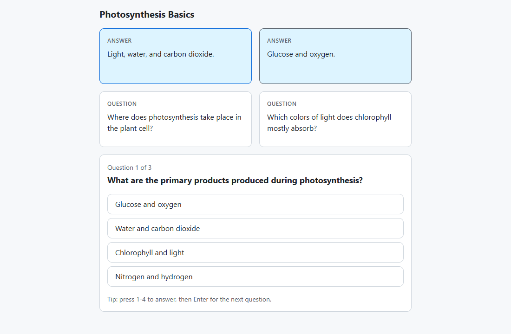
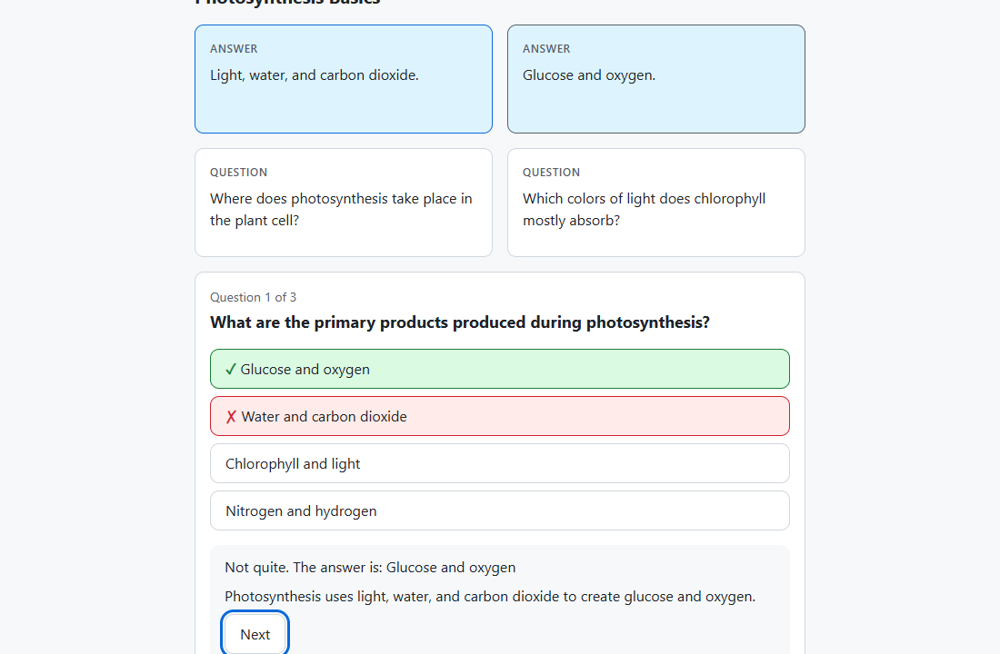
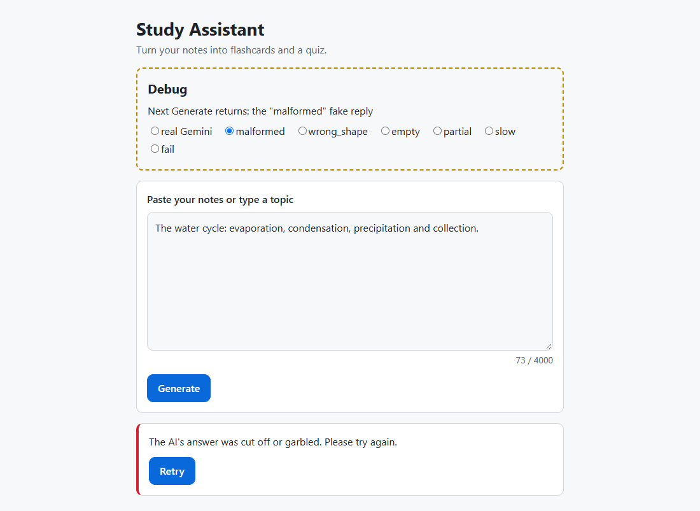
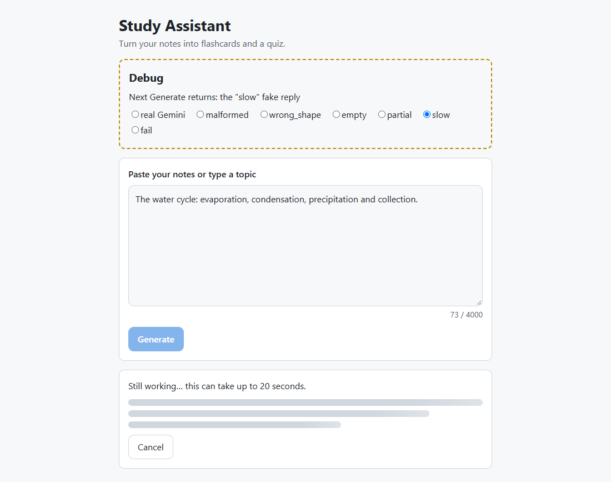

# Study Assistant

Paste your notes, or just type a topic, and get flashcards and a multiple-choice
quiz. Flip the cards, take the quiz, then re-test only the questions you got
wrong. An AI model writes the study material as structured JSON; the app checks
every item before anything reaches the screen. It is not a chatbot: raw model
text is never shown.

**Live demo:** LIVE_DEMO_URL

**Recording:** [watch the 90-second demo](docs/media/demo.webm) (a scripted
walkthrough with real Gemini answers; see "How this was built" below)

| Flashcards | Quiz feedback |
| --- | --- |
|  |  |
| **Bad AI output, handled** | **A slow answer** |
|  |  |

## What it does

- **One free-form text box** for notes or a topic (up to 4,000 characters,
  with a live counter that turns red over the limit).
- **Flashcards** that flip between question and answer (click, Enter or Space).
- **A quiz**, one question at a time: keys 1-4 answer, the right option gets a
  tick and a wrong pick a cross, an explanation follows, and Enter moves on.
- **Results** with the score, and **"Retest the misses"** to start a new round
  with only the questions answered wrong.
- **Every state has a screen:** an empty state before anything is generated,
  loading (with "Still working…" after 5 seconds and Cancel), errors (a clear
  message and Retry), and a note when broken items were skipped.
- **The last set is saved** in the browser and comes back after a refresh.
- **Works on phones and in dark mode:** one column on phones, two columns of
  cards on wider screens, 44px touch targets, colours that follow the system's
  light or dark setting, and no animations for people who ask for reduced motion.

## How it works

```
Browser (React)                                Server function                    Gemini
TopicForm ── notes ──► useStudySet ──► POST /api/generate ──────────────────► generateContent
                          │            local: Vite forwards /api to          (asked for JSON
                          │            server/dev-server.js on :8787;         in a fixed schema)
                          │            live: Vercel runs api/generate.js
                          │            Both call generateStudySet(): checks the notes, adds the key
                          │        ◄── { ok: true, text }  or  { ok: false, error: { code, message } }
                          ▼
                 parseStudySet  ◄── the checkpoint: every piece of outside data passes here
                    ├─ ok      → cards + quiz on screen, set saved in localStorage
                    └─ not ok  → a clear message + Retry
```

One rule holds the design together: **nothing from outside our own code
reaches the screen without passing `parseStudySet`**. That covers the AI's
answer and the set saved in the browser. The checkpoint never throws; it
returns either clean data or a reason (`empty`, `malformed`, `wrong_shape`).

The server's job is narrow: keep the API key secret, reject bad input before it
costs a model call, give up after 20 seconds, and turn every failure into one
JSON shape. All of that lives in one function, `generateStudySet` in
`server/studySet.js`, so the local server and the deployed Vercel Function run
exactly the same code.

**Main files**

```
src/App.jsx                    The page: holds the current set and shows the parts below
src/components/                TopicForm, Flashcard, Quiz, Results, StatusView, DebugPanel
src/hooks/useStudySet.js       One request at a time: status word, Cancel, Retry, stale-answer guard
src/hooks/useQuiz.js           The quiz rules in one reducer (answer, next, re-test the misses)
src/lib/api.js                 The only fetch call; always returns { ok, ... }
src/lib/parseStudySet.js       The checkpoint (+ tests), with the Zod rules in schema.js
src/lib/storage.js             Saves the last set; loading goes through the checkpoint
src/index.css                  All the styling: CSS variables, dark mode, mobile first
server/studySet.js             The whole server: input checks, Gemini call, error codes, debug replies (+ tests)
server/dev-server.js           Local API server for npm start (Node's built-in http module)
api/generate.js                The Vercel Function: calls the same generateStudySet
docs/                          Learning log, tool notes, screenshots and the recording
```

## Getting started

Needs only **Node.js 22.12 or newer**.

```bash
git clone https://github.com/RishitheB0T/study-assistant.git
cd study-assistant
npm install
```

Get a free Gemini API key at https://aistudio.google.com/apikey, copy
`.env.example` to `.env`, and paste the key after `GEMINI_API_KEY=`. `.env` is
git-ignored and is read only by the server.

```bash
npm start
```

Open http://localhost:5173. `npm start` runs the web app (Vite, port 5173) and
the API server (port 8787) together. Without a key the app still starts:
Generate then says the server has no API key, and every debug mode below still
works. If port 8787 is taken, run `API_PORT=8790 npm start` (macOS/Linux/Git
Bash) to use another port.

Other commands: `npm test` (32 automatic tests), `npm run build` (production
build into `dist/`).

**Deploying:** import the repository on vercel.com, add `GEMINI_API_KEY` under
Environment Variables, and deploy. Vercel builds the Vite app and turns
`api/generate.js` into a function (`vercel.json` gives it up to 30 seconds).

## The API

`POST /api/generate` with the body `{ "notes": "..." }` always replies with one
of two shapes:

```json
{ "ok": true, "text": "...the model's raw JSON answer..." }
{ "ok": false, "error": { "code": "TIMEOUT", "message": "..." } }
```

| Code | HTTP status | When |
| --- | --- | --- |
| `BAD_INPUT` | 400 | Notes are empty or longer than 4,000 characters, the body is not JSON, or the debug mode is unknown |
| `NO_KEY` | 500 | The server has no `GEMINI_API_KEY` |
| `TIMEOUT` | 504 | Gemini took longer than 20 seconds |
| `RATE_LIMITED` | 429 | Gemini's rate limit was hit (`Retry-After` is passed on when Gemini sends it) |
| `PROVIDER_ERROR` | 502 | Gemini rejected the request, blocked the input, was overloaded, or could not be reached |

Any method other than POST gets 405. The server never checks the study set
itself; the browser's checkpoint does.

## How bad AI output is handled

| What goes wrong | Where it is caught | What the user sees |
| --- | --- | --- |
| Empty, too long or non-JSON input | `generateStudySet`, before any model call | A clear message and Retry |
| Gemini is slow | 20-second timeout on the server; "Still working…" after 5 seconds | Cancel at any time, then a timeout message and Retry |
| Gemini fails, is overloaded or rate-limited | The server maps it to one error code | A clear message and Retry |
| The answer is cut off or not JSON | The checkpoint: `malformed` | "The AI's answer was cut off or garbled." and Retry |
| JSON in the wrong shape | The checkpoint: `wrong_shape` | "The AI answered in an unexpected format." and Retry |
| No usable items at all | The checkpoint: `empty` | "The AI returned no usable cards." and Retry |
| Some items broken (missing fields, 3 options, repeated ids) | The checkpoint keeps the good items | The set, plus "2 items were skipped" |
| An old, slow answer arrives after a newer one | Every request is numbered; only the newest may update the screen | Never shown |
| The saved set is corrupted or outdated | The checkpoint, on page load | The app starts empty instead of crashing |

### Debug mode: showing it on demand

Open http://localhost:5173/?debug=1 (or the live URL with `?debug=1`). A dashed
"Debug" panel appears above the text box. Pick a mode and press Generate: the
server returns a fake reply instead of calling Gemini (so it costs nothing),
and the app has to handle it like a real one.

| Mode | The server returns | The app shows |
| --- | --- | --- |
| real Gemini | a real answer | the cards and the quiz |
| `malformed` | cut-off JSON | "cut off or garbled" and Retry |
| `wrong_shape` | `{"cards": []}` | "unexpected format" and Retry |
| `empty` | an empty answer | "no usable cards" and Retry |
| `partial` | a set with 2 broken items | the set and "2 items were skipped" |
| `slow` | a valid set after 8 seconds | "Still working…" after 5 seconds; Cancel keeps the current set |
| `fail` | `502 PROVIDER_ERROR` | the error and Retry |

Retry uses the mode selected at that moment: pick `fail`, press Generate, then
switch to "real Gemini" and press Retry. The same modes work from any HTTP
client: `POST /api/generate?chaos=malformed`.

## Decisions and trade-offs

- **The checkpoint runs in the browser.** The server only passes the model's
  text on. One gate then covers every source of outside data (the AI's answer
  and the saved set), and it is tested on its own with Vitest. The cost is that
  bad data travels to the browser before it is rejected, which is cheap here.
- **Keep the good items, skip the bad ones.** One broken card does not throw
  away a useful set; the user is told how many were skipped.
- **A JSON schema for the model, and validation anyway.** The schema makes good
  output likely; Zod makes sure only valid items reach the screen.
- **One status word** (`idle`, `loading`, `success`, `error`) instead of several
  true/false flags that could contradict each other.
- **Numbered requests for the stale-answer guard.** Cancel also aborts the
  request, but aborting alone is not enough: an answer can already be arriving.
- **One server function, two doors.** The server started as a Spring Boot app,
  which I know well. It was moved to a single Node function so that the whole
  project runs on Node alone (`npm install && npm start`, no JDK) and deploys
  as one Vercel project. The rules, messages and debug modes stayed the same.
- **Plain `fetch` everywhere, no AI SDK and no HTTP library,** so there is
  nothing hidden to explain.
- **Debug failures are produced on the server,** as text, so the real
  checkpoint and error paths are exercised rather than faked in the browser.
- **Plain CSS with variables.** Dark mode is one media query that swaps the
  variables; there is no CSS framework to learn or explain.

## Known limitations

- When Gemini is briefly overloaded (HTTP 503, which happened several times
  while recording the demo), the user sees an error and has to press Retry;
  there is no automatic retry.
- Our own endpoint has no rate limit, so anyone with the live URL could use up
  the free Gemini quota. Debug modes are also available on the live site; they
  never call Gemini, but `slow` keeps a function busy for 8 seconds.
- Only the last set is saved, not the quiz progress: after a refresh the quiz
  starts again from question 1.
- Dark mode follows the device setting; there is no switch in the app.
- The phone layout was checked in phone-sized browser windows (320 to 390
  pixels wide), not on real devices.
- There is no favicon, so the browser logs a harmless 404 for `/favicon.ico`.

## What I would do next

1. One automatic retry on the server for Gemini 503s, and a per-visitor rate
   limit on `/api/generate`.
2. Auto-repair: when the checkpoint rejects an answer, ask the model once more
   with the list of problems.
3. Save quiz progress, then a list of saved sets to reopen, rename and delete.
4. Export and import a set as a JSON file, imported through the same checkpoint.
5. GitHub Actions running `npm test` on every push, plus tests for the quiz
   reducer and the components.
6. More card types (true/false, fill in the blank).

## How this was built (AI usage)

I built this with an AI coding assistant (Claude, by Anthropic), step by step
from a plan I drew up with its help.

- **Code:** the AI assistant wrote most of the code to my instructions, one
  piece at a time, and explained each piece to me. I wrote some parts myself:
  the re-test button on the results screen, the colouring of right and wrong
  quiz options, the error box with Retry, the debug-mode picker, five of the
  checkpoint tests and a first version of saving to the browser. The assistant
  reviewed those and fixed or tightened several of them. The final submission
  pass (moving the server from Spring Boot to one Node/Vercel function, the
  styling, the screenshots, the recording and this README) was done by the
  assistant working through a task list I wrote.
- **Commits:** I made the first commit. Every later commit was made and pushed
  by the assistant under my Git name, at my request.
- **Recording and screenshots:** scripted. The assistant drove a real browser
  through the app with a script; the Gemini answers in it are real, and
  captions replace narration.
- **My part:** I chose the project, directed every step, made the design
  decisions with the assistant's advice, reviewed and tested each step, and
  kept a learning log of every file so that I can explain, debug and extend it.

## Time spent

Measured two ways, without rounding down:

- **My own estimate of hands-on time** for building the core app (setup through
  saving, keyboard controls and the phone layout): about 7 hours 45 minutes.
- **The commit history:** more than 60 commits in five working sessions between 15 and
  17 November 2026. Counting only from the first to the last commit of each
  session gives about 8.5 hours, including the final submission pass. Real
  working time was longer than that, because each session began with reading
  and planning before its first commit; the first session alone started about
  half an hour before its first commit.

So the total is roughly 9 to 10 hours, somewhat over the brief's suggested 8.
